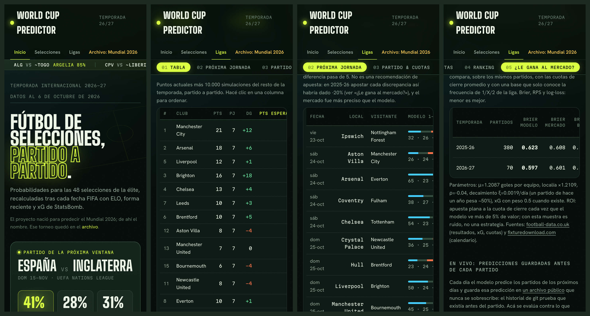

# 🏆 World Cup Predictor

[](https://github.com/demianc14/WC_predictor/actions/workflows/ci.yml)

> El proyecto nació como predictor del **Mundial 2026** (grupos reales del sorteo del 5-dic-2025) y de ahí conserva el nombre. Terminado el torneo (🇪🇸 España campeona, 1-0 a Argentina el 19-jul), hoy predice dos cosas: **selecciones** en la temporada internacional 2026-27 y las **cinco grandes ligas** europeas (Premier League, LaLiga, Bundesliga, Serie A y Ligue 1), con un modelo supervisado comparado de forma honesta contra el mercado y un ciclo diario que publica cada predicción antes del partido y la mide después. El Mundial quedó como archivo.
>
> **Web:** https://demianc14.github.io/WC_predictor/ (se actualiza sola cada día)

- **Datos al 6-oct-2026**: incluye la ventana del 23-sep al 6-oct (UEFA y Concacaf Nations League, clasificación a la Copa África, amistosos)
- **Pipeline ETL** validado con Pydantic (fail fast)
- **xG real de StatsBomb Open Data**: 250 partidos (Euro 2020, Mundial 2022, AFCON 2023, Euro 2024, Copa América 2024) → ratings de xG sin penales ajustados por rival y por recencia, que reemplazan en parte el xG curado del CSV
- **Modelo de fuerzas** inspirado en Bayes: 20% historia + 50% actualidad = 70% base estadística + 30% contexto del partido
- **Motor Maher + Dixon-Coles**: ataque/defensa separados y corrección ρ=−0.13 de marcadores bajos; prórroga y penales
- **Breaking News Engine**: eventos canónicos elegibles desde menú + inyección manual
- **Interfaz web** autocontenida (`app/index.html`). El menú tiene Inicio, Selecciones, Ligas y Archivo; cada sección se divide en subsecciones:
  - **Selecciones 2026-27**: próxima ventana (predicciones del 11 al 17-nov: Nations League, Concacaf, clasif. Copa África, amistosos), última ventana (resultados vs. lo que esperaba el modelo, quién subió y bajó), partido y cuotas a 90' entre cualquier par, ranking (fuerza, Δ ventana, ELO, forma de los últimos 5, valor de plantilla, edad, xG)
  - **Ligas · cinco grandes**: un selector de liga y, para cada una, tabla proyectada (10.000 temporadas simuladas), próxima jornada contra las cuotas, partido y cuotas entre cualquier par de clubes, ranking (xPts contra un rival promedio, ataque contra defensa) y backtest contra el mercado
  - **Archivo · Mundial 2026**: dos cuadros (cómo terminó y lo que esperaba el modelo, que acertó 26 de 31 partidos), probabilidad exacta de llegar a cada ronda y backtest

## La web en imágenes


Un recorrido por las vistas: inicio, próxima ventana, tabla proyectada, jornada contra las cuotas, el modelo contra el mercado, ranking y el cuadro del Mundial.


En el celular (inicio, tabla, próxima jornada y "¿le gana al mercado?"):



Capturas de la web real al 21-oct-2026, generadas con `python -m tools.capturas` (Chrome headless). El mismo script escribe las portadas para compartir el proyecto: [`linkedin-1200x627.png`](docs/img/linkedin-1200x627.png) y [`linkedin-1080x1350.png`](docs/img/linkedin-1080x1350.png).

## xG de StatsBomb

`src/etl/scrapers/statsbomb.py` baja los eventos de cada partido una sola vez y guarda solo un resumen de tiros (`data/cache/statsbomb/shots/`, ~1.8 MB para los 250 partidos). `src/etl/xg_ratings.py` ajusta `npxG(i vs j) ≈ MU × ataque_i × defensa_j` por mínimos cuadrados ponderados, con peso `exp(-edad/730 días)` y 2 partidos ficticios de shrinkage. El ETL mezcla ese xG con el del CSV según la muestra efectiva de cada equipo (`n_eff / (n_eff + 2)`) y escribe el detalle en `data/processed/xg_statsbomb.json`.

Cobertura: 40 de las 48 selecciones del modelo. Sin datos: Bosnia, Haití, Curazao, Nueva Zelanda, Irak, Noruega, Jordania y Uzbekistán (usan el xG del CSV). El Mundial 2026 todavía no está en el open data.

## Clubes: las cinco grandes ligas

`src/clubs/` reutiliza la matriz Dixon-Coles del proyecto, pero ajusta los parámetros a cada liga en vez de heredarlos de las selecciones. Ligas: Premier League (E0), LaLiga (SP1), Bundesliga (D1), Serie A (I1) y Ligue 1 (F1), configuradas en `leagues.py`.

- **Datos** (`data.py`): CSVs de [football-data.co.uk](https://www.football-data.co.uk/) con resultados, cuotas de cierre y xG (este último solo desde 2026-27, en las diez divisiones), más `fixtures.csv` con los partidos de los próximos días y sus cuotas. Caché en `data/cache/clubs/`; la temporada actual se refresca cada 12 h.
- **Calendario** (`calendar.py`): la temporada completa sale de [fixturedownload.com](https://fixturedownload.com/). Los nombres no coinciden con los de football-data, así que el cruce se deduce de los partidos ya jugados (mismo día ±1 y mismo marcador) y falla con el nombre exacto si un equipo queda sin pareja. También exige una liga a dos ruedas: el feed de Ligue 1 trae Rennes-PSG dos veces y ningún PSG-Rennes, se corrige a la vista (consola y `calendar_fixes` en el JSON). Si el feed no está disponible, la simulación usa todo cruce no jugado.
- **Modelo** (`model.py`): ataque y defensa por club, localía, μ y ρ por máxima verosimilitud Poisson (algoritmo iterativo de Maher, sin scipy), con peso `exp(−0.0019·días)` y 3 goles ficticios de shrinkage. Se ajusta junto con la segunda división para que los ascendidos lleguen con historia. Cuando hay xG, el objetivo es 50% goles + 50% xG.
- **Temporada** (`season.py`): Monte Carlo de los partidos que faltan → puntos esperados y probabilidad de cada puesto.
- **Partido y cuotas** (`h2h.py`): cualquier cruce de una liga con los parámetros publicados en `clubs_<div>.json`: 1X2, goles, ambos anotan, marcadores, cuota justa y EV/¼-Kelly contra las cuotas que le pases. La web usa la misma fórmula y da los mismos números. A diferencia de selecciones, no hay noticias ni contexto: solo ataque, defensa y localía estimados con los partidos.
- **Contra el mercado** (`backtest.py`): walk-forward semanal. Sobre los mismos partidos se comparan el modelo, las cuotas de cierre promedio sin margen y una base que solo conoce la frecuencia de 1/X/2 de la liga hasta esa semana.

```bash
python -m src.clubs.run                 # las cinco: escribe data/processed/clubs_<div>.json
python -m src.clubs.run --league SP1    # una sola
python -m src.clubs.h2h SP1 barcelona "real madrid" --odds 1.95 3.9 3.6   # partido y cuotas
python -m tools.export_frontend         # lo inyecta en la web
```

Brier y RPS 1X2, menor es mejor; en negrita, el mejor entre modelo y mercado:

| Liga | Temporada | Partidos | Brier modelo | Brier mercado | Brier base | RPS modelo | RPS mercado | RPS base |
|---|---|---|---|---|---|---|---|---|
| Premier League | 2025-26 | 380 | 0.623 | **0.608** | 0.656 | 0.212 | **0.204** | 0.228 |
| Premier League | 2026-27 (al 19-oct) | 70 | **0.597** | 0.601 | 0.663 | **0.197** | 0.198 | 0.229 |
| LaLiga | 2025-26 | 380 | 0.579 | **0.572** | 0.633 | 0.200 | **0.196** | 0.224 |
| LaLiga | 2026-27 (al 19-oct) | 88 | 0.562 | **0.538** | 0.654 | 0.183 | **0.174** | 0.225 |
| Bundesliga | 2025-26 | 306 | 0.575 | **0.562** | 0.649 | 0.196 | **0.190** | 0.232 |
| Bundesliga | 2026-27 (al 19-oct) | 54 | **0.572** | 0.591 | 0.627 | **0.203** | 0.211 | 0.231 |
| Serie A | 2025-26 | 380 | 0.598 | **0.583** | 0.661 | 0.203 | **0.196** | 0.234 |
| Serie A | 2026-27 (al 19-oct) | 70 | 0.564 | **0.542** | 0.638 | 0.208 | **0.199** | 0.242 |
| Ligue 1 | 2025-26 | 306 | 0.599 | **0.582** | 0.644 | 0.207 | **0.200** | 0.229 |
| Ligue 1 | 2026-27 (al 19-oct) | 63 | 0.591 | **0.579** | 0.647 | 0.206 | **0.200** | 0.232 |

El modelo le gana con claridad a la base en todas las ligas, pero **pierde contra el mercado en las cinco en la temporada completa 2025-26**. En 2026-27 lo supera en la Premier y la Bundesliga, con 54 a 70 partidos: muy pocos para decir que sea mejor. Apostar cada discrepancia de más de 5% habría perdido entre 9% y 29% en 2025-26 según la liga, así que la web muestra dónde discrepa el modelo, no "valor".

## Modelo supervisado (1X2, clubes)

`src/ml/` plantea cada partido de las cinco ligas como una clasificación 1/X/2 y lo compara de forma honesta con el Dixon-Coles y con el mercado. El reporte completo, con tablas por liga, intervalos, calibración y ablación, lo genera el código: [`docs/RESULTADOS_ML.md`](docs/RESULTADOS_ML.md).

```bash
python -m src.ml.train --leagues all     # features, validación, test, artefactos y reporte
python -m src.ml.report data/ml/runs/<fecha>_<huella>   # regenera el reporte sin reentrenar
```

- **Features**, todas calculadas antes del partido: ELO de clubes, forma de los últimos 5, días de descanso (también contando Champions y Europa League), liga y, en una variante, las probabilidades y λ del Dixon-Coles reajustado cada lunes. Las cuotas no son feature: solo sirven de benchmark. El xG queda afuera porque solo existe desde 2026-27. Un test cambia resultados futuros y comprueba que ninguna feature pasada se mueve.
- **Modelos**: base de frecuencias, regresión logística multinomial (sin y con Dixon-Coles) y `HistGradientBoostingClassifier`.
- **Validación walk-forward mensual**: los hiperparámetros se eligen en 2023-24 y 2024-25; el test es 2025-26 y lo que va de 2026-27. Entrena desde 2020-21, con 2019-20 solo como historia previa.

Test con las cinco ligas juntas (2.098 partidos, la misma muestra para todos; menor es mejor):

| Modelo | RPS [IC 95%] | Log-loss |
|---|---|---|
| Base (frecuencias) | 0.2294 [0.2263, 0.2324] | 1.0715 |
| Logística sin Dixon-Coles | 0.2020 [0.1960, 0.2078] | 0.9914 |
| Logística + Dixon-Coles | 0.2019 [0.1963, 0.2074] | 0.9908 |
| Gradient boosting (+ Europa) | 0.2034 [0.1976, 0.2089] | 0.9969 |
| Dixon-Coles | 0.2027 [0.1977, 0.2078] | 0.9936 |
| **Mercado (cierre)** | **0.1971 [0.1918, 0.2024]** | **0.9742** |

**Conclusión: el supervisado no mejora al Dixon-Coles y no alcanza al mercado.** La logística con Dixon-Coles queda a −0.0008 de RPS del Dixon-Coles (IC 95% −0.0019 a +0.0003, no se distingue) y a +0.0048 del mercado (IC +0.0026 a +0.0070, peor). Los cuatro modelos están bien calibrados, también en empates (predicen 25.3-25.5% y hubo 25.2%). El gradient boosting no supera a la logística: con unos 11.000 partidos y señales casi lineales no hay interacciones que aprovechar. Sumar Champions y Europa League al descanso tampoco ayuda: en validación la logística empeora apenas (log-loss 0.9806 → 0.9811) y el boosting que la elige no se distingue del Dixon-Coles en test.

El Dixon-Coles de este test se reajusta con los 3 años previos; el de la tabla por liga de más arriba usa toda la historia en caché, por eso sus Brier difieren hasta en 0.001.

## Ciclo diario y métricas en vivo

Cada día a las 05:30 UTC, GitHub Actions (`.github/workflows/daily.yml`) corre `python -m src.pipeline.daily` y, si algo cambió, el bot lo commitea:

1. **Descarga** una vez cada fuente viva: la temporada actual de las 10 divisiones, `fixtures.csv` y los 5 calendarios. Todo pasa por una carpeta temporal y se valida. Si una sola falla o llega vacía, el ciclo termina con código 2, no modifica nada y GitHub avisa por correo del workflow fallido.
2. **Ajusta** cada liga (el mismo Dixon-Coles de la web) y **predice** los partidos de los próximos días que todavía no tienen predicción para la versión actual del modelo. La versión es el hash git del árbol `src/clubs/`: cambia solo cuando cambia el código del modelo.
3. **Registra** los resultados de lo ya jugado y su cuota de cierre, y **recalcula** las métricas en vivo.
4. Recién entonces **escribe**: los JSON por liga, `data/processed/live.json`, el almacén y la web. `.github/workflows/pages.yml` la publica en GitHub Pages junto con los JSON.

**Dónde viven las predicciones:** [`data/predictions/predicciones.csv`](data/predictions/predicciones.csv), una fila por partido y versión del modelo, con la hora UTC en que se hizo. Una predicción guardada **nunca se sobrescribe**: el código lo verifica contra el archivo antes de escribir, y el historial de git prueba que cada fila existía antes del partido. Solo se completan después el resultado y la cuota de cierre.

**Cómo leer la métrica en vivo:** se evalúa la primera predicción de cada partido contra lo que pasó y, sobre los mismos partidos, contra la cuota de cierre sin margen (Brier y RPS, menor es mejor). Es la única evaluación sin posibilidad de fuga de datos, pero **con pocas semanas no es concluyente**: el backtest de arriba necesitó temporadas enteras para separar al modelo del mercado.

```bash
python -m src.pipeline.daily      # el mismo ciclo, a mano (descarga, predice, registra, exporta)
gh workflow run daily.yml         # en GitHub
```

## Reproducir con Docker

Sin instalar Python. Un mismo `Dockerfile` arma dos imágenes sobre `python:3.11-slim` (la misma versión que CI). Las dos corren con un usuario sin privilegios y no llevan datos ni secretos:

| Imagen | Para qué | Tamaño |
|---|---|---|
| `wc-predictor` | ciclo diario, web, ligas, partido y cuotas (solo el núcleo: numpy, pandas, pydantic) | 439 MB |
| `wc-predictor:ml` | entrenamiento del modelo supervisado y la suite de tests (suma scikit-learn y pytest) | 742 MB |

```bash
make docker-build    # construye las dos con la versión del modelo y el commit de git
make docker-test     # docker run --rm wc-predictor:ml pytest -q  → los mismos 122 tests que CI
make docker-daily    # el ciclo diario con ./data y ./app montados (escribe con tu usuario)
make docker-train    # el entrenamiento completo, con ./data y ./docs montados
make docker-serve    # la web en http://localhost:8000
```

- **Qué se monta**: `./data` (caché de las fuentes, JSON procesados, almacén de predicciones y artefactos de ML) en `/app/data`. El ciclo diario monta también `./app`, porque actualiza la web, y el entrenamiento monta `./docs`, porque escribe el reporte.
- **Versión del modelo**: dentro del contenedor no hay `.git`, así que `make docker-build` graba en las imágenes el hash de `src/clubs/` y el commit. Una predicción hecha desde Docker lleva la misma versión que las del bot y no se duplica.
- **Dependencias opcionales**: `pip install ".[ml]"` (scikit-learn, para `src/ml`), `".[llm]"` (anthropic, para las crónicas generativas) y `".[dev]"` (todo, más las herramientas). `ANTHROPIC_API_KEY` entra en tiempo de ejecución con `-e`, nunca en la imagen; sin el paquete o sin clave, el narrador usa plantillas.
- **Fuera de las imágenes** (`.dockerignore`): `.git`, entornos, cachés, `data/cache`, `data/ml`, `data/processed`, `data/predictions` y `docs`.
- **CI** construye las imágenes y corre la suite adentro en cada push (`make docker-build docker-test`).

## Arquitectura

El corazón del proyecto es un **pipeline ETL** (`src/etl/`) que toma datos crudos de las 48 selecciones (`data/raw/teams_2026.csv`), los valida con contratos Pydantic (fail fast: una fila corrupta detiene el pipeline con un mensaje exacto de qué falló) y calcula una **fuerza por equipo** combinando 20% historia mundialista + 50% forma/xG reciente. Ese CSV es solo el punto de partida: el ETL lo enriquece con scrapers en vivo (ELO actual de eloratings.net, historial de partidos desde 1872 para resiliencia y forma dinámica, valor de plantilla de Transfermarkt), cada uno con la misma **degradación elegante** del narrador — si una fuente falla, el pipeline cae al valor del CSV en vez de romperse. Esa fuerza (70% base estadística) se combina en tiempo de partido con un 30% de contexto (lesiones, clima, altura, hinchada) inyectado por el Breaking News Engine. El resultado se serializa a `data/processed/strengths_2026.json`, única fuente de verdad tanto para la CLI como para la app web.

Los goles se modelan con un **motor Maher + Dixon-Coles** (`src/simulation/match_engine.py`): Maher (1982) separa perfiles de ataque y defensa por equipo en vez de usar un solo número de fuerza, y Dixon-Coles (1997) corrige el sesgo conocido del Poisson independiente en marcadores bajos (subestima 0-0/1-1, sobreestima 1-0/0-1) con un factor ρ=−0.13 calibrado sobre la literatura. Un torneo completo (`src/simulation/tournament.py`) arma el cuadro oficial de la FIFA (M73–M104), resuelve la asignación de los 8 mejores terceros a sus llaves por backtracking, y resuelve empates en eliminación directa con prórroga y penales. Para responder preguntas probabilísticas ("¿qué tan probable es que Argentina sea campeón?") se corren miles de torneos independientes (**Monte Carlo**) y se cuenta la frecuencia de cada resultado — el error de la estimación cae como 1/√N, lo que fija cuántas simulaciones vale la pena correr (10.000 mundiales, 50.000 partidos cara a cara).

El único punto de contacto con un LLM es el narrador (`src/agents/narrator.py`), y es deliberadamente opcional: por defecto genera crónicas con plantillas f-string, y solo si existe `ANTHROPIC_API_KEY` y se pasa `--llm` usa Claude para crónicas generativas. Es un patrón de **degradación elegante** — todo el sistema (ETL, motor de partido, torneo, Monte Carlo) funciona sin el LLM, que aquí es una mejora cosmética, no una dependencia. Por eso el proyecto se llama "Predictor" y no "Simulador LLM": la predicción es 100% estadística.

Los clubes (`src/clubs/`) reutilizan la matriz Dixon-Coles, pero estiman sus parámetros por liga con los partidos de football-data. El modelo supervisado (`src/ml/`) usa esas mismas probabilidades como una feature más y se evalúa con walk-forward contra el Dixon-Coles y el mercado. El ciclo diario (`src/pipeline/`) solo orquesta: descarga todo o nada, predice, registra en un almacén solo-para-agregar y exporta la web. El detalle está en las Partes II a IV de la [bitácora](docs/PROYECTO_OBSIDIAN.md#parte-ii--clubes-las-cinco-grandes-ligas).

## Quickstart

```bash
python3 -m venv .venv && source .venv/bin/activate
pip install -e ".[dev]"

python -m src.cli etl                  # pipeline ETL
python -m src.cli simulate --seed 2026 # una copa fase a fase
python -m src.cli montecarlo -n 2000   # ¿quién gana la copa?
python -m src.cli h2h BRA MAR          # Brasil vs Marruecos
python -m src.cli backtest             # ¿qué tan bien predijo el Mundial real?
python -m src.etl.xg_ratings           # ranking xG de StatsBomb (desde la caché)
python -m tools.export_frontend        # reinyecta fuerzas y última ventana en app/index.html
python -m tools.capturas               # capturas y GIF de la web en docs/img/ (pip install pillow)
pytest                                 # 122 tests, sin red
ruff check .                           # lo mismo que corre CI
mypy                                   # tipos: src/ y tools/ (configurado en pyproject.toml)
```

**Datos versionados:** `data/cache/` (~18 MB) va en el repo a propósito: con la caché, el ETL, los backtests y las cifras de este README se reproducen sin red y aunque una fuente cambie o desaparezca. Las temporadas cerradas no se vuelven a bajar; lo vivo se refresca cada 12 h.

**Interfaz para amigos:** abre `app/index.html` en el navegador. Sin servidor, sin instalación. Tras cada `etl`, correr `python -m tools.export_frontend` para actualizarla. La vista "Última ventana" compara contra `data/snapshots/strengths_2026-09-22.json` (fuerzas congeladas antes de la ventana); en la próxima fecha FIFA, guardar un snapshot nuevo y actualizar `WINDOW_SNAPSHOT`/`WINDOW_FROM` en `tools/export_frontend.py`.

**Próxima ventana:** el calendario vive en `data/raw/fixtures_2026-11.csv` (curado a mano desde UEFA, Concacaf, NBC Sports y ESPN; nombres como en martj42). Los rivales fuera de las 48 se estiman desde su ELO con una recta ajustada sobre las 48 (R² ≈ 0.87 en la fuerza) y la web los marca con ≈. Las fuerzas con que se predijo quedaron en `data/snapshots/strengths_2026-10-15.json`. Cuando termine la ventana, ese snapshot pasa a ser el `WINDOW_SNAPSHOT` de "Última ventana".

## ¿Qué tan bien predijo?

### Última ventana (23-sep al 6-oct-2026)

127 partidos de las 48 selecciones (UEFA y Concacaf Nations League, clasificación a la Copa África, amistosos). En los 35 que enfrentaron a dos selecciones del modelo, con las fuerzas congeladas al 22-sep (`data/snapshots/strengths_2026-09-22.json`):

| Métrica | Modelo | Azar |
|---|---|---|
| Acierta el resultado más probable | **57%** (20/35) | 33% |
| Brier 1X2 | **0.529** | 0.667 |

Más subieron: Bosnia (+0.029), Estados Unidos (+0.023), Suecia (+0.021). Más bajaron: Ghana (−0.031), Turquía (−0.026), Egipto (−0.015). La muestra es chica: sirve para seguir al modelo fecha a fecha, no para sacar conclusiones. El detalle partido a partido está en la vista "Última ventana" de la web.

### Archivo: Mundial 2026

Backtest contra los 104 partidos reales del Mundial 2026, usando el modelo tal como estaba el 15-jun (sin ver resultados posteriores). Se compara contra un ELO pre-torneo reconstruido desde el historial y contra el azar. En Brier score, menor es mejor:

| Tramo | Modelo | ELO | Azar |
|---|---|---|---|
| Grupos, 1X2 (72) | **0.478** | 0.541 | 0.667 |
| Grupos fuera de muestra (48) | **0.408** | 0.442 | 0.667 |
| Eliminatorias, ¿quién clasifica? (32) | **0.134** | 0.148 | 0.250 |

El modelo supera al azar con claridad y al ELO en la estimación puntual. Pero en los tramos sin fuga de datos la ventaja sobre ELO cae dentro del margen de error (bootstrap al 95%). Está bien calibrado: cuando dice 28% pasa el 29%, y cuando dice 68% pasa el 70%. Subestima un poco los empates (21% vs 27.8%). Reajustar K/BASE/ρ con estos datos no mejora de forma significativa, así que se mantienen. Detalle y metodología en [`docs/PROYECTO_OBSIDIAN.md` §10.1](docs/PROYECTO_OBSIDIAN.md#101-backtest-el-modelo-contra-los-104-partidos-reales).

## Limitaciones

- **Cobertura de datos en vivo limitada a 48 selecciones**: los scrapers (ELO, historial, valor de plantilla) solo mapean los equipos del Mundial 2026 — el CSV curado sigue siendo el fallback y la base para cualquier otro cruce.
- **"Bayes" es una combinación lineal**, no inferencia bayesiana formal — es una inspiración conceptual (prior actualizado por evidencia), útil y transparente, pero no el teorema aplicado con distribuciones.
- El sesgo de independencia del Poisson en marcadores bajos ya está corregido (Dixon-Coles) con un ρ fijo de la literatura. Estimarlo sobre el Mundial 2026 no es concluyente; hace falta ajustarlo sobre el historial completo.
- **Validación con poca muestra**: 80 partidos fuera de muestra no alcanzan para afirmar que el modelo supera a un ELO bien hecho, solo que no es peor.

## Cómo escalar

El proyecto está pensado para crecer sin tocar el motor de partido: más selecciones o torneos, ajustar ρ y el modelo de empates sobre el historial completo, refresco automático del ETL, persistencia de simulaciones, etc. Cada cambio se puede validar con el mismo `backtest`. Lo hecho y lo pendiente (lesiones y alineaciones como features, xG en el supervisado, más selecciones) está en [`docs/PROYECTO_OBSIDIAN.md` §16](docs/PROYECTO_OBSIDIAN.md#16-roadmap).

## Documentación completa

Toda la explicación conceptual está en [`docs/PROYECTO_OBSIDIAN.md`](docs/PROYECTO_OBSIDIAN.md), lista para importar a Obsidian: principios de diseño, el motor de selecciones y el Mundial (Parte I), clubes (II), modelo supervisado (III), operación con ciclo diario, CI y Docker (IV), limitaciones y roadmap.

Otros documentos:
- [`docs/RESULTADOS_ML.md`](docs/RESULTADOS_ML.md): reporte del modelo supervisado, generado por el código.
- `docs/PROMPT_AGENTE_FASE1.md` … `FASE5.md`: el brief de cada fase del roadmap de las cinco ligas.
