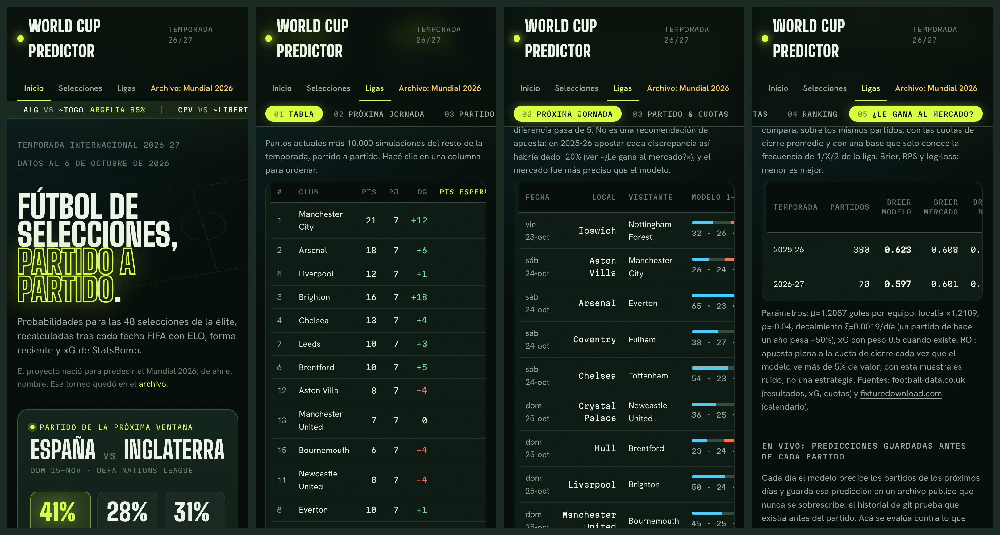

# World Cup Predictor

[](https://github.com/demianc14/WC_predictor/actions/workflows/ci.yml)

Predictor de fútbol para las cinco grandes ligas europeas, la Champions League y las selecciones, con un ciclo diario que publica cada predicción antes del partido y la mide después. **Web:** https://demianc14.github.io/WC_predictor/ (se actualiza sola cada día).

- **Ciclo diario todo o nada:** `python -m src.pipeline.daily` descarga todas las fuentes a una carpeta temporal; si una falla o llega vacía, termina con código 2 y no modifica nada ([cómo funciona](#ciclo-diario-y-métricas-en-vivo)).
- **Almacén solo para agregar, auditado por git:** [`data/predictions/predicciones.csv`](data/predictions/predicciones.csv) nunca se sobrescribe (el código lo verifica antes de escribir) y el historial de git prueba que cada fila existía antes del partido.
- **Evaluación honesta contra el mercado:** Brier, RPS y log-loss sobre la misma muestra para modelo, base y cuotas de cierre, siempre con n. Resultado actual: el modelo le gana a la base, pero [pierde contra el mercado](#clubes-las-cinco-grandes-ligas) en las cinco ligas en 2025-26.
- **160 tests sin red** (`pytest --collect-only`), más ruff y mypy en CI.

> El proyecto nació como predictor del Mundial 2026 y de ahí conserva el nombre. El Mundial, las selecciones y el Breaking News Engine están en el [archivo](docs/archivo-mundial.md).

## La web

`app/index.html` es autocontenida. El menú tiene Inicio, Selecciones, Ligas y Archivo:

- **Champions**: próximos partidos con el 1X2 del modelo conjunto, tabla de la fase de liga con P(octavos), P(playoff) y P(afuera), y backtest contra la base
- **Ligas · cinco grandes**: un selector de liga y, para cada una, tabla proyectada (10.000 temporadas simuladas), próxima jornada contra las cuotas, partido y cuotas entre cualquier par de clubes, ranking (xPts contra un rival promedio, ataque contra defensa) y backtest contra el mercado
- **Selecciones y Archivo · Mundial 2026**: ver el [archivo](docs/archivo-mundial.md)


## La web en imágenes


Un recorrido por las vistas: inicio, próxima ventana, tabla proyectada, jornada contra las cuotas, el modelo contra el mercado, ranking y el cuadro del Mundial.


En el celular (inicio, tabla, próxima jornada y "¿le gana al mercado?"):



Capturas de la web real al 21-oct-2026, generadas con `python -m tools.capturas` (Chrome headless). El mismo script escribe las portadas para compartir el proyecto: [`linkedin-1200x627.png`](docs/img/linkedin-1200x627.png) y [`linkedin-1080x1350.png`](docs/img/linkedin-1080x1350.png).

## Clubes: las cinco grandes ligas

`src/clubs/` reutiliza la matriz Dixon-Coles del proyecto, pero ajusta los parámetros a cada liga en vez de heredarlos de las selecciones. Ligas: Premier League (E0), LaLiga (SP1), Bundesliga (D1), Serie A (I1) y Ligue 1 (F1), configuradas en `leagues.py`.

- **Datos** (`data.py`): CSVs de [football-data.co.uk](https://www.football-data.co.uk/) con resultados, cuotas de cierre y xG (este último solo desde 2026-27, en las diez divisiones), más `fixtures.csv` con los partidos de los próximos días y sus cuotas. Caché en `data/cache/clubs/`; la temporada actual se refresca cada 12 h.
- **Calendario** (`calendar.py`): la temporada completa sale de [fixturedownload.com](https://fixturedownload.com/). Los nombres no coinciden con los de football-data, así que el cruce se deduce de los partidos ya jugados (mismo día ±1 y mismo marcador) y falla con el nombre exacto si un equipo queda sin pareja. También exige una liga a dos ruedas: el feed de Ligue 1 trae Rennes-PSG dos veces y ningún PSG-Rennes, se corrige a la vista (consola y `calendar_fixes` en el JSON). Si el feed no está disponible, la simulación usa todo cruce no jugado.
- **Modelo** (`model.py`): ataque y defensa por club, localía, μ y ρ por máxima verosimilitud Poisson (algoritmo iterativo de Maher, sin scipy), con peso `exp(−0.0019·días)` y 3 goles ficticios de shrinkage. Se ajusta junto con la segunda división para que los ascendidos lleguen con historia. Cuando hay xG, el objetivo es 50% goles + 50% xG.
- **Temporada** (`season.py`): Monte Carlo de los partidos que faltan → puntos esperados y probabilidad de cada puesto.
- **Partido y cuotas** (`h2h.py`): cualquier cruce de una liga con los parámetros publicados en `clubs_<div>.json`: 1X2, goles, ambos anotan, marcadores, cuota justa y EV/¼-Kelly contra las cuotas que le pases. La web usa la misma fórmula y da los mismos números. A diferencia de selecciones, no hay noticias ni contexto: solo ataque, defensa y localía estimados con los partidos.
- **Contra el mercado** (`backtest.py`): walk-forward semanal. Sobre los mismos partidos se comparan el modelo, las cuotas de cierre promedio sin margen y una base que solo conoce la frecuencia de 1/X/2 de la liga hasta esa semana.

```bash
python -m src.clubs.run                 # las cinco: escribe data/processed/clubs_<div>.json
python -m src.clubs.run --league SP1    # una sola
python -m src.clubs.h2h SP1 barcelona "real madrid" --odds 1.95 3.9 3.6   # partido y cuotas
python -m tools.export_frontend         # lo inyecta en la web
```

Brier y RPS 1X2, menor es mejor; en negrita, el mejor entre modelo y mercado:

| Liga | Temporada | Partidos | Brier modelo | Brier mercado | Brier base | RPS modelo | RPS mercado | RPS base |
|---|---|---|---|---|---|---|---|---|
| Premier League | 2025-26 | 380 | 0.623 | **0.608** | 0.656 | 0.212 | **0.204** | 0.228 |
| Premier League | 2026-27 (al 19-oct) | 70 | **0.597** | 0.601 | 0.663 | **0.197** | 0.198 | 0.229 |
| LaLiga | 2025-26 | 380 | 0.579 | **0.572** | 0.633 | 0.200 | **0.196** | 0.224 |
| LaLiga | 2026-27 (al 19-oct) | 88 | 0.562 | **0.538** | 0.654 | 0.183 | **0.174** | 0.225 |
| Bundesliga | 2025-26 | 306 | 0.575 | **0.562** | 0.649 | 0.196 | **0.190** | 0.232 |
| Bundesliga | 2026-27 (al 19-oct) | 54 | **0.572** | 0.591 | 0.627 | **0.203** | 0.211 | 0.231 |
| Serie A | 2025-26 | 380 | 0.598 | **0.583** | 0.661 | 0.203 | **0.196** | 0.234 |
| Serie A | 2026-27 (al 19-oct) | 70 | 0.564 | **0.542** | 0.638 | 0.208 | **0.199** | 0.242 |
| Ligue 1 | 2025-26 | 306 | 0.599 | **0.582** | 0.644 | 0.207 | **0.200** | 0.229 |
| Ligue 1 | 2026-27 (al 19-oct) | 63 | 0.591 | **0.579** | 0.647 | 0.206 | **0.200** | 0.232 |

El modelo le gana con claridad a la base en todas las ligas, pero **pierde contra el mercado en las cinco en la temporada completa 2025-26**. En 2026-27 lo supera en la Premier y la Bundesliga, con 54 a 70 partidos: muy pocos para decir que sea mejor. Apostar cada discrepancia de más de 5% habría perdido entre 9% y 29% en 2025-26 según la liga, así que la web muestra dónde discrepa el modelo, no "valor".

## Champions League 2026-27

Cada liga tiene su propio Dixon-Coles, y sus ratings no se comparan entre sí. Para la Champions, `src/europe/` ajusta un solo modelo con el mismo `fit` sobre todas estas fuentes:
- las cinco grandes ligas con sus segundas divisiones;
- seis ligas más de football-data: Países Bajos, Portugal, Turquía, Bélgica, Grecia y Escocia;
- todos los partidos de Champions y Europa League desde 2019. Estos cruces son los que ponen a todas las ligas en la misma escala.

Con eso predice cada partido de la fase de liga y simula 10.000 veces el resto de la temporada: la tabla de 36 (top 8, playoff o afuera) y después el cuadro de eliminatorias del reglamento 2026/27, hasta la probabilidad de cada club de ser campeón. La web muestra el cuadro como quedaría si la fase de liga terminara hoy, o según la proyección del modelo.

```bash
python -m src.europe.backtest                  # walk-forward contra la base
python -m src.europe.backtest --fase test      # calibración del empate → docs/ucl/test.json
python -m src.europe.run                       # → data/processed/ucl.json
```

En las Champions 2024-25 y 2025-26 (n = 376, misma muestra; `docs/ucl/test.json`), el modelo tiene Brier 0.524, RPS 0.195 y log-loss 0.897. La base, que solo conoce la frecuencia de 1/X/2, tiene 0.610, 0.238 y 1.009. **No hay comparación con el mercado**, porque football-data no publica cuotas de la Champions.

El modelo sobrestima el empate: predice 22,2% y hubo 15,7%. Se probó corregirlo con un factor elegido en validación (Champions 2021-22 a 2023-24, `docs/ucl/validacion.json`) y medido una sola vez en el test. La regla, escrita antes de mirar, pedía una mejora de log-loss mayor que 0,012 con un IC que excluyera el cero. La corrección mejora 0,0059 (IC 95% −0.0098 a −0.0020), así que **no se adopta**. Si el 15,7% viene del formato de 36 clubes o es ruido sigue siendo una hipótesis abierta. El detalle está en la [bitácora §12.5](docs/PROYECTO_OBSIDIAN.md).

## Modelo supervisado (1X2, clubes)

`src/ml/` plantea cada partido de las cinco ligas como una clasificación 1/X/2 y lo compara de forma honesta con el Dixon-Coles y con el mercado. El reporte completo, con tablas por liga, intervalos, calibración y ablación, lo genera el código: [`docs/RESULTADOS_ML.md`](docs/RESULTADOS_ML.md).

```bash
python -m src.ml.train --leagues all     # features, validación, test, artefactos y reporte
python -m src.ml.report data/ml/runs/<fecha>_<huella>   # regenera el reporte sin reentrenar
```

- **Features**, todas calculadas antes del partido: ELO de clubes, forma de los últimos 5, días de descanso (también contando Champions y Europa League), liga y, en una variante, las probabilidades y λ del Dixon-Coles reajustado cada lunes. Las cuotas no son feature: solo sirven de benchmark. El xG queda afuera porque solo existe desde 2026-27. Un test cambia resultados futuros y comprueba que ninguna feature pasada se mueve.
- **Modelos**: base de frecuencias, regresión logística multinomial (sin y con Dixon-Coles) y `HistGradientBoostingClassifier`.
- **Validación walk-forward mensual**: los hiperparámetros se eligen en 2023-24 y 2024-25; el test es 2025-26 y lo que va de 2026-27. Entrena desde 2020-21, con 2019-20 solo como historia previa.

Test con las cinco ligas juntas (2.098 partidos, la misma muestra para todos; menor es mejor):

| Modelo | RPS [IC 95%] | Log-loss |
|---|---|---|
| Base (frecuencias) | 0.2294 [0.2263, 0.2324] | 1.0715 |
| Logística sin Dixon-Coles | 0.2020 [0.1960, 0.2078] | 0.9914 |
| Logística + Dixon-Coles | 0.2019 [0.1963, 0.2074] | 0.9908 |
| Gradient boosting (+ Europa) | 0.2034 [0.1976, 0.2089] | 0.9969 |
| Dixon-Coles | 0.2027 [0.1977, 0.2078] | 0.9936 |
| **Mercado (cierre)** | **0.1971 [0.1918, 0.2024]** | **0.9742** |

**Conclusión: el supervisado no mejora al Dixon-Coles y no alcanza al mercado.** La logística con Dixon-Coles queda a −0.0008 de RPS del Dixon-Coles (IC 95% −0.0019 a +0.0003, no se distingue) y a +0.0048 del mercado (IC +0.0026 a +0.0070, peor). Los cuatro modelos están bien calibrados, también en empates (predicen 25.3-25.5% y hubo 25.2%). El gradient boosting no supera a la logística: con unos 11.000 partidos y señales casi lineales no hay interacciones que aprovechar. Sumar Champions y Europa League al descanso tampoco ayuda: en validación la logística empeora apenas (log-loss 0.9806 → 0.9811) y el boosting que la elige no se distingue del Dixon-Coles en test.

El Dixon-Coles de este test se reajusta con los 3 años previos; el de la tabla por liga de más arriba usa toda la historia en caché, por eso sus Brier difieren hasta en 0.001.

## Ciclo diario y métricas en vivo

Cada día, GitHub Actions (`.github/workflows/daily.yml`) corre `python -m src.pipeline.daily` (dos crons, a las 00:17 y a las 05:30 UTC; GitHub los dispara con horas de atraso, medido en la bitácora §14.1) y, si algo cambió, el bot lo commitea:

1. **Descarga** una vez cada fuente viva: la temporada actual de las 10 divisiones, `fixtures.csv` y los 5 calendarios. Todo pasa por una carpeta temporal y se valida. Si una sola falla o llega vacía, el ciclo termina con código 2, no modifica nada y GitHub avisa por correo del workflow fallido.
2. **Ajusta** cada liga (el mismo Dixon-Coles de la web) y **predice** los partidos de los próximos días que todavía no tienen predicción para la versión actual del modelo. La versión es el hash git del árbol `src/clubs/`: cambia solo cuando cambia el código del modelo.
3. **Registra** los resultados de lo ya jugado y su cuota de cierre, y **recalcula** las métricas en vivo.
4. Recién entonces **escribe**: los JSON por liga, `data/processed/live.json`, el almacén y la web. `.github/workflows/pages.yml` la publica en GitHub Pages junto con los JSON.

**Dónde viven las predicciones:** [`data/predictions/predicciones.csv`](data/predictions/predicciones.csv), una fila por partido y versión del modelo, con la hora UTC en que se hizo. Una predicción guardada **nunca se sobrescribe**: el código lo verifica contra el archivo antes de escribir, y el historial de git prueba que cada fila existía antes del partido. Solo se completan después el resultado y la cuota de cierre.

**Cómo leer la métrica en vivo:** se evalúa la primera predicción de cada partido contra lo que pasó y, sobre los mismos partidos, contra la cuota de cierre sin margen (Brier y RPS, menor es mejor). Es la única evaluación sin posibilidad de fuga de datos, pero **con pocas semanas no es concluyente**: el backtest de arriba necesitó temporadas enteras para separar al modelo del mercado.

```bash
python -m src.pipeline.daily      # el mismo ciclo, a mano (descarga, predice, registra, exporta)
gh workflow run daily.yml         # en GitHub
```

## Reproducir con Docker

Sin instalar Python. Un mismo `Dockerfile` arma dos imágenes sobre `python:3.11-slim` (la misma versión que CI). Las dos corren con un usuario sin privilegios y no llevan datos ni secretos:

| Imagen | Para qué | Tamaño |
|---|---|---|
| `wc-predictor` | ciclo diario, web, ligas, partido y cuotas (solo el núcleo: numpy, pandas, pydantic) | 439 MB |
| `wc-predictor:ml` | entrenamiento del modelo supervisado y la suite de tests (suma scikit-learn y pytest) | 742 MB |

```bash
make docker-build    # construye las dos con la versión del modelo y el commit de git
make docker-test     # docker run --rm wc-predictor:ml pytest -q  → los mismos 160 tests que CI
make docker-daily    # el ciclo diario con ./data y ./app montados (escribe con tu usuario)
make docker-train    # el entrenamiento completo, con ./data y ./docs montados
make docker-serve    # la web en http://localhost:8000
```

- **Qué se monta**: `./data` (caché de las fuentes, JSON procesados, almacén de predicciones y artefactos de ML) en `/app/data`. El ciclo diario monta también `./app`, porque actualiza la web, y el entrenamiento monta `./docs`, porque escribe el reporte.
- **Versión del modelo**: dentro del contenedor no hay `.git`, así que `make docker-build` graba en las imágenes el hash de `src/clubs/` y el commit. Una predicción hecha desde Docker lleva la misma versión que las del bot y no se duplica.
- **Dependencias opcionales**: `pip install ".[ml]"` (scikit-learn, para `src/ml`), `".[llm]"` (anthropic, para las crónicas generativas) y `".[dev]"` (todo, más las herramientas). `ANTHROPIC_API_KEY` entra en tiempo de ejecución con `-e`, nunca en la imagen; sin el paquete o sin clave, el narrador usa plantillas.
- **Fuera de las imágenes** (`.dockerignore`): `.git`, entornos, cachés, `data/cache`, `data/ml`, `data/processed`, `data/predictions` y `docs`.
- **CI** construye las imágenes y corre la suite adentro en cada push (`make docker-build docker-test`).

## Arquitectura

Los clubes (`src/clubs/`) usan un Dixon-Coles (Maher + corrección de marcadores bajos) con parámetros estimados por liga con los partidos de football-data. La Champions (`src/europe/`) usa el mismo ajuste sobre todas las ligas juntas más los partidos europeos. El modelo supervisado (`src/ml/`) usa esas mismas probabilidades como una feature más y se evalúa con walk-forward contra el Dixon-Coles y el mercado. El ciclo diario (`src/pipeline/`) solo orquesta: descarga todo o nada, predice, registra en un almacén solo-para-agregar y exporta la web. Ninguna predicción depende de un LLM. El detalle está en las Partes II a IV de la [bitácora](docs/PROYECTO_OBSIDIAN.md#parte-ii--clubes-las-cinco-grandes-ligas); el motor de selecciones, en el [archivo](docs/archivo-mundial.md#arquitectura-de-selecciones).

## Quickstart

```bash
python3 -m venv .venv && source .venv/bin/activate
pip install -e ".[dev]"

python -m src.clubs.run                # ajusta las cinco ligas
python -m src.europe.run               # Champions
python -m src.pipeline.daily           # ciclo diario completo
python -m tools.export_frontend        # reinyecta los datos en app/index.html
python -m tools.capturas               # capturas y GIF de la web en docs/img/ (pip install pillow)
pytest                                 # 160 tests, sin red
ruff check .                           # lo mismo que corre CI
mypy                                   # tipos: src/ y tools/ (configurado en pyproject.toml)
```

Los comandos de selecciones (`python -m src.cli …`) están en el [archivo](docs/archivo-mundial.md#comandos-de-selecciones).

**Datos versionados:** `data/cache/` (~18 MB) va en el repo a propósito: con la caché, los backtests y las cifras de este README se reproducen sin red y aunque una fuente cambie o desaparezca. Las temporadas cerradas no se vuelven a bajar; lo vivo se refresca cada 12 h.

## Limitaciones

- **El mercado le gana al modelo** en las cinco ligas (backtest 2025-26 y en vivo desde el 20-oct), y el supervisado no cambia eso. Por eso la web muestra dónde discrepa el modelo, nunca "valor".
- **La Champions no tiene benchmark de mercado:** football-data no publica sus cuotas, así que solo se compara contra la base. Además, el modelo conjunto sobrestima el empate (22% contra 16%): una corrección medida en test no llegó al umbral fijado de antemano. Y 7 de los 36 clubes no tienen liga en la fuente.
- **Las métricas en vivo tienen semanas, no temporadas:** todavía no permiten conclusiones.
- Las limitaciones del modelo de selecciones están en el [archivo](docs/archivo-mundial.md#limitaciones-de-selecciones).

## Cómo escalar

El proyecto está pensado para crecer sin tocar el motor de partido, y cada cambio se valida con su walk-forward antes de entrar. La cola de trabajo, con contexto y criterio de cierre por tarea, está en [`docs/ROADMAP.md`](docs/ROADMAP.md). Lo que sigue es guardar las eliminatorias de la Champions cuando el feed las publique y terminar de medir el horario del ciclo diario. El historial está en [`docs/PROYECTO_OBSIDIAN.md` §16](docs/PROYECTO_OBSIDIAN.md#16-roadmap).

## Documentación completa

Toda la explicación conceptual está en [`docs/PROYECTO_OBSIDIAN.md`](docs/PROYECTO_OBSIDIAN.md), lista para importar a Obsidian: principios de diseño, el motor de selecciones y el Mundial (Parte I, resumido en el [archivo](docs/archivo-mundial.md)), clubes (II), modelo supervisado (III), operación con ciclo diario, CI y Docker (IV), limitaciones y roadmap.

Otros documentos:
- [`docs/ROADMAP.md`](docs/ROADMAP.md): la cola de trabajo, con contexto, pasos y criterio de cierre por tarea.
- [`docs/RESULTADOS_ML.md`](docs/RESULTADOS_ML.md): reporte del modelo supervisado, generado por el código.
- `docs/briefs/FASE1.md` … `FASE5.md`: el brief de cada fase del roadmap de las cinco ligas.
