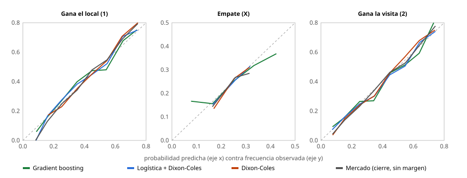

# Resultados del modelo supervisado (1X2, clubes)

> Generado por `python -m src.ml.train --leagues all`. No editar a mano.

- Fecha: 2026-10-22 · commit `8347a73` · huella del dataset `9bd592bc9bef` · semilla 2627
- Ligas: Premier League, LaLiga, Bundesliga, Serie A, Ligue 1
- Partidos jugados con features: 11080
- Temporadas: historia previa 2019-20; entrenamiento 2020-21, 2021-22, 2022-23; validación 2023-24, 2024-25; test 2025-26, 2026-27
- Versiones: scikit-learn 1.9.1, numpy 2.4.6, pandas 3.0.3
- Artefactos: `data/ml/runs/2026-10-22_9bd592bc9bef/` (predicciones, métricas, modelos)

## Conclusión

El mejor supervisado en test, «Logística + Dixon-Coles» (RPS 0.2019), no se distingue del Dixon-Coles (diferencia de RPS -0.0008, IC 95% -0.0019 a +0.0003) y queda por detrás del mercado (diferencia +0.0048, IC 95% +0.0026 a +0.0070).

## Test: todas las ligas juntas

Misma muestra para todos: 2098 partidos de test con Dixon-Coles y cuotas de cierre. Brier (0 a 2), RPS (0 a 1) y log-loss: menor es mejor. Entre corchetes, el intervalo bootstrap al 95%.

| Modelo | n | Brier | RPS | Log-loss |
|---|---|---|---|---|
| Base (frecuencias 1X2) | 2098 | 0.6479 [0.6414, 0.6544] | 0.2294 [0.2263, 0.2324] | 1.0715 [1.0619, 1.0812] |
| Logística sin Dixon-Coles | 2098 | 0.5901 [0.5751, 0.6043] | 0.2020 [0.1960, 0.2078] | 0.9914 [0.9700, 1.0114] |
| Logística + Dixon-Coles | 2098 | 0.5900 [0.5755, 0.6039] | 0.2019 [0.1963, 0.2074] | 0.9908 [0.9702, 1.0106] |
| Gradient boosting | 2098 | 0.5939 [0.5793, 0.6080] | 0.2034 [0.1976, 0.2089] | 0.9969 [0.9758, 1.0173] |
| Dixon-Coles | 2098 | 0.5920 [0.5788, 0.6048] | 0.2027 [0.1977, 0.2078] | 0.9936 [0.9747, 1.0116] |
| Mercado (cierre, sin margen) | 2098 | 0.5797 [0.5654, 0.5929] | **0.1971 [0.1918, 0.2024]** | 0.9742 [0.9543, 0.9931] |

### Diferencias pareadas (negativo = el primero es mejor)

| Comparación | ΔRPS [IC 95%] | ΔLog-loss [IC 95%] |
|---|---|---|
| Logística sin Dixon-Coles − Dixon-Coles | -0.0008 [-0.0026, 0.0010] | -0.0022 [-0.0082, 0.0038] |
| Logística sin Dixon-Coles − Mercado (cierre, sin margen) | 0.0048 [0.0024, 0.0072] | 0.0173 [0.0095, 0.0251] |
| Logística + Dixon-Coles − Dixon-Coles | -0.0008 [-0.0019, 0.0003] | -0.0028 [-0.0066, 0.0011] |
| Logística + Dixon-Coles − Mercado (cierre, sin margen) | 0.0048 [0.0026, 0.0070] | 0.0167 [0.0098, 0.0237] |
| Gradient boosting − Dixon-Coles | 0.0007 [-0.0009, 0.0022] | 0.0033 [-0.0029, 0.0094] |
| Gradient boosting − Mercado (cierre, sin margen) | 0.0063 [0.0038, 0.0088] | 0.0227 [0.0140, 0.0316] |
| Dixon-Coles − Mercado (cierre, sin margen) | 0.0056 [0.0033, 0.0078] | 0.0195 [0.0124, 0.0262] |

## Test por liga y temporada

| Liga | Temporada | Modelo | n | Brier | RPS | Log-loss |
|---|---|---|---|---|---|---|
| Bundesliga | 2025-26 | Base (frecuencias 1X2) | 306 | 0.6480 | 0.2315 | 1.0710 |
| Bundesliga | 2025-26 | Logística sin Dixon-Coles | 306 | 0.5663 | 0.1922 | 0.9583 |
| Bundesliga | 2025-26 | Logística + Dixon-Coles | 306 | 0.5677 | 0.1926 | 0.9611 |
| Bundesliga | 2025-26 | Gradient boosting | 306 | 0.5705 | 0.1940 | 0.9664 |
| Bundesliga | 2025-26 | Dixon-Coles | 306 | 0.5748 | 0.1955 | 0.9725 |
| Bundesliga | 2025-26 | Mercado (cierre, sin margen) | 306 | **0.5618** | **0.1901** | **0.9510** |
| Bundesliga | 2026-27 | Base (frecuencias 1X2) | 54 | 0.6225 | 0.2290 | 1.0343 |
| Bundesliga | 2026-27 | Logística sin Dixon-Coles | 54 | 0.5833 | 0.2077 | 0.9715 |
| Bundesliga | 2026-27 | Logística + Dixon-Coles | 54 | 0.5831 | 0.2064 | 0.9733 |
| Bundesliga | 2026-27 | Gradient boosting | 54 | 0.5888 | 0.2076 | 0.9958 |
| Bundesliga | 2026-27 | Dixon-Coles | 54 | **0.5726** | **0.2033** | **0.9574** |
| Bundesliga | 2026-27 | Mercado (cierre, sin margen) | 54 | 0.5908 | 0.2115 | 0.9845 |
| Premier League | 2025-26 | Base (frecuencias 1X2) | 380 | 0.6569 | 0.2281 | 1.0857 |
| Premier League | 2025-26 | Logística sin Dixon-Coles | 380 | 0.6260 | 0.2125 | 1.0402 |
| Premier League | 2025-26 | Logística + Dixon-Coles | 380 | 0.6246 | 0.2122 | 1.0379 |
| Premier League | 2025-26 | Gradient boosting | 380 | 0.6319 | 0.2147 | 1.0469 |
| Premier League | 2025-26 | Dixon-Coles | 380 | 0.6230 | 0.2120 | 1.0361 |
| Premier League | 2025-26 | Mercado (cierre, sin margen) | 380 | **0.6077** | **0.2045** | **1.0118** |
| Premier League | 2026-27 | Base (frecuencias 1X2) | 70 | 0.6636 | 0.2285 | 1.0952 |
| Premier League | 2026-27 | Logística sin Dixon-Coles | 70 | 0.6087 | 0.2022 | 1.0147 |
| Premier League | 2026-27 | Logística + Dixon-Coles | 70 | 0.6012 | 0.1993 | 1.0047 |
| Premier League | 2026-27 | Gradient boosting | 70 | 0.5982 | 0.1981 | 0.9993 |
| Premier League | 2026-27 | Dixon-Coles | 70 | **0.5971** | **0.1968** | **0.9988** |
| Premier League | 2026-27 | Mercado (cierre, sin margen) | 70 | 0.6008 | 0.1982 | 1.0055 |
| Ligue 1 | 2025-26 | Base (frecuencias 1X2) | 306 | 0.6447 | 0.2298 | 1.0665 |
| Ligue 1 | 2025-26 | Logística sin Dixon-Coles | 306 | 0.5969 | 0.2074 | 0.9992 |
| Ligue 1 | 2025-26 | Logística + Dixon-Coles | 306 | 0.5974 | 0.2070 | 0.9993 |
| Ligue 1 | 2025-26 | Gradient boosting | 306 | 0.6013 | 0.2079 | 1.0063 |
| Ligue 1 | 2025-26 | Dixon-Coles | 306 | 0.5973 | 0.2067 | 0.9991 |
| Ligue 1 | 2025-26 | Mercado (cierre, sin margen) | 306 | **0.5820** | **0.2003** | **0.9755** |
| Ligue 1 | 2026-27 | Base (frecuencias 1X2) | 63 | 0.6458 | 0.2321 | 1.0675 |
| Ligue 1 | 2026-27 | Logística sin Dixon-Coles | 63 | 0.5922 | 0.2061 | 0.9900 |
| Ligue 1 | 2026-27 | Logística + Dixon-Coles | 63 | 0.5905 | 0.2055 | 0.9901 |
| Ligue 1 | 2026-27 | Gradient boosting | 63 | 0.5778 | 0.2013 | 0.9717 |
| Ligue 1 | 2026-27 | Dixon-Coles | 63 | 0.5904 | 0.2055 | 0.9926 |
| Ligue 1 | 2026-27 | Mercado (cierre, sin margen) | 63 | **0.5788** | **0.1998** | **0.9757** |
| Serie A | 2025-26 | Base (frecuencias 1X2) | 380 | 0.6592 | 0.2332 | 1.0870 |
| Serie A | 2025-26 | Logística sin Dixon-Coles | 380 | 0.5950 | 0.2014 | 0.9979 |
| Serie A | 2025-26 | Logística + Dixon-Coles | 380 | 0.5956 | 0.2019 | 0.9988 |
| Serie A | 2025-26 | Gradient boosting | 380 | 0.5996 | 0.2042 | 1.0057 |
| Serie A | 2025-26 | Dixon-Coles | 380 | 0.5980 | 0.2030 | 1.0011 |
| Serie A | 2025-26 | Mercado (cierre, sin margen) | 380 | **0.5830** | **0.1961** | **0.9784** |
| Serie A | 2026-27 | Base (frecuencias 1X2) | 70 | 0.6358 | 0.2421 | 1.0516 |
| Serie A | 2026-27 | Logística sin Dixon-Coles | 70 | 0.5499 | 0.2005 | 0.9385 |
| Serie A | 2026-27 | Logística + Dixon-Coles | 70 | 0.5553 | 0.2032 | 0.9459 |
| Serie A | 2026-27 | Gradient boosting | 70 | **0.5364** | **0.1955** | **0.9185** |
| Serie A | 2026-27 | Dixon-Coles | 70 | 0.5632 | 0.2075 | 0.9574 |
| Serie A | 2026-27 | Mercado (cierre, sin margen) | 70 | 0.5421 | 0.1990 | 0.9246 |
| LaLiga | 2025-26 | Base (frecuencias 1X2) | 380 | 0.6328 | 0.2237 | 1.0503 |
| LaLiga | 2025-26 | Logística sin Dixon-Coles | 380 | 0.5766 | 0.1990 | 0.9784 |
| LaLiga | 2025-26 | Logística + Dixon-Coles | 380 | 0.5760 | 0.1988 | 0.9743 |
| LaLiga | 2025-26 | Gradient boosting | 380 | 0.5854 | 0.2022 | 0.9869 |
| LaLiga | 2025-26 | Dixon-Coles | 380 | 0.5787 | 0.1997 | 0.9767 |
| LaLiga | 2025-26 | Mercado (cierre, sin margen) | 380 | **0.5717** | **0.1958** | **0.9650** |
| LaLiga | 2026-27 | Base (frecuencias 1X2) | 89 | 0.6507 | 0.2242 | 1.0757 |
| LaLiga | 2026-27 | Logística sin Dixon-Coles | 89 | 0.5516 | 0.1812 | 0.9344 |
| LaLiga | 2026-27 | Logística + Dixon-Coles | 89 | 0.5525 | 0.1819 | 0.9358 |
| LaLiga | 2026-27 | Gradient boosting | 89 | 0.5541 | 0.1827 | 0.9387 |
| LaLiga | 2026-27 | Dixon-Coles | 89 | 0.5626 | 0.1841 | 0.9531 |
| LaLiga | 2026-27 | Mercado (cierre, sin margen) | 89 | **0.5407** | **0.1758** | **0.9164** |

## Calibración

Tramos de 0.1 con al menos 15 partidos. Sobre la diagonal punteada, el modelo dice lo que después pasa.

### Empates

| Modelo | P(X) media predicha | Empates reales |
|---|---|---|
| Base (frecuencias 1X2) | 0.254 | 0.252 |
| Logística sin Dixon-Coles | 0.253 | 0.252 |
| Logística + Dixon-Coles | 0.254 | 0.252 |
| Gradient boosting | 0.255 | 0.252 |
| Dixon-Coles | 0.248 | 0.252 |
| Mercado (cierre, sin margen) | 0.252 | 0.252 |

## Validación: elección de hiperparámetros

Walk-forward mensual en 2023-24 y 2024-25 (filas con Dixon-Coles). En cada familia gana el de menor log-loss; el test no se usa para elegir.

| Candidato | n | Brier | RPS | Log-loss |
|---|---|---|---|---|
| ✓ base | 3504 | 0.6521 | 0.2307 | 1.0769 |
| logit_basic (C=0.01) | 3504 | 0.5855 | 0.1981 | 0.9816 |
| ✓ logit_basic (C=0.1) | 3504 | 0.5855 | 0.1981 | 0.9815 |
| logit_basic (C=1.0) | 3504 | 0.5856 | 0.1981 | 0.9815 |
| logit_basic + Europa (C=0.01) | 3504 | 0.5860 | 0.1984 | 0.9822 |
| logit_basic + Europa (C=0.1) | 3504 | 0.5856 | 0.1983 | 0.9815 |
| logit_basic + Europa (C=1.0) | 3504 | 0.5856 | 0.1983 | 0.9815 |
| ✓ logit_dc (C=0.01) | 3504 | 0.5847 | 0.1979 | 0.9806 |
| logit_dc (C=0.1) | 3504 | 0.5848 | 0.1979 | 0.9807 |
| logit_dc (C=1.0) | 3504 | 0.5849 | 0.1980 | 0.9808 |
| logit_dc + Europa (C=0.01) | 3504 | 0.5851 | 0.1981 | 0.9811 |
| logit_dc + Europa (C=0.1) | 3504 | 0.5849 | 0.1981 | 0.9807 |
| logit_dc + Europa (C=1.0) | 3504 | 0.5849 | 0.1981 | 0.9806 |
| hgb (learning_rate=0.03, max_leaf_nodes=8, min_samples_leaf=40) | 3504 | 0.5922 | 0.2007 | 0.9927 |
| hgb (learning_rate=0.03, max_leaf_nodes=8, min_samples_leaf=120) | 3504 | 0.5924 | 0.2007 | 0.9937 |
| hgb (learning_rate=0.03, max_leaf_nodes=16, min_samples_leaf=40) | 3504 | 0.5972 | 0.2022 | 1.0020 |
| hgb (learning_rate=0.03, max_leaf_nodes=16, min_samples_leaf=120) | 3504 | 0.5977 | 0.2026 | 1.0026 |
| hgb (learning_rate=0.06, max_leaf_nodes=8, min_samples_leaf=40) | 3504 | 0.5982 | 0.2025 | 1.0023 |
| hgb (learning_rate=0.06, max_leaf_nodes=8, min_samples_leaf=120) | 3504 | 0.5973 | 0.2024 | 1.0027 |
| hgb (learning_rate=0.06, max_leaf_nodes=16, min_samples_leaf=40) | 3504 | 0.6077 | 0.2054 | 1.0205 |
| hgb (learning_rate=0.06, max_leaf_nodes=16, min_samples_leaf=120) | 3504 | 0.6093 | 0.2063 | 1.0229 |
| ✓ hgb + Europa (learning_rate=0.03, max_leaf_nodes=8, min_samples_leaf=40) | 3504 | 0.5914 | 0.2002 | 0.9919 |
| hgb + Europa (learning_rate=0.03, max_leaf_nodes=8, min_samples_leaf=120) | 3504 | 0.5918 | 0.2004 | 0.9931 |
| hgb + Europa (learning_rate=0.03, max_leaf_nodes=16, min_samples_leaf=40) | 3504 | 0.5964 | 0.2021 | 1.0007 |
| hgb + Europa (learning_rate=0.03, max_leaf_nodes=16, min_samples_leaf=120) | 3504 | 0.5974 | 0.2023 | 1.0025 |
| hgb + Europa (learning_rate=0.06, max_leaf_nodes=8, min_samples_leaf=40) | 3504 | 0.5964 | 0.2018 | 1.0003 |
| hgb + Europa (learning_rate=0.06, max_leaf_nodes=8, min_samples_leaf=120) | 3504 | 0.5975 | 0.2024 | 1.0032 |
| hgb + Europa (learning_rate=0.06, max_leaf_nodes=16, min_samples_leaf=40) | 3504 | 0.6082 | 0.2057 | 1.0209 |
| hgb + Europa (learning_rate=0.06, max_leaf_nodes=16, min_samples_leaf=120) | 3504 | 0.6071 | 0.2056 | 1.0196 |
| Dixon-Coles | 3504 | 0.5853 | 0.1985 | 0.9819 |

### Ablación (logística, features agregadas de a una, validación)

| Features | n | Brier | RPS | Log-loss |
|---|---|---|---|---|
| ELO | 3504 | 0.5861 | 0.1983 | 0.9828 |
| + forma | 3504 | 0.5855 | 0.1980 | 0.9817 |
| + descanso | 3504 | 0.5855 | 0.1979 | 0.9817 |
| + liga | 3504 | 0.5855 | 0.1981 | 0.9816 |
| + Dixon-Coles | 3504 | 0.5847 | 0.1979 | 0.9806 |
| + Europa | 3504 | 0.5851 | 0.1981 | 0.9811 |

## Método y límites

- **Sin fuga de datos**: cada fila usa solo partidos de días anteriores; lo verifica `tests/test_ml_features.py` cambiando resultados futuros y comprobando que las features no se mueven. El walk-forward entrena solo con meses anteriores al que predice.
- **Las cuotas no son feature**: solo se usan como benchmark.
- **Features**: ELO de clubes (K=20, +60 de localía), forma de los últimos 5 (puntos, goles a favor y en contra), días de descanso (tope 21), liga y, en los modelos con Dixon-Coles, sus probabilidades y λ reajustados cada lunes.
- **No entran**: xG (solo existe desde 2026-27), partidos de copa y de Europa (el descanso solo ve la liga), lesiones y alineaciones.
- **2020-21 se jugó mayormente sin público**: la ventaja de local de ese año es atípica y forma parte del entrenamiento.
- **2026-27 está en curso**: su muestra es chica y sus métricas se mueven cada semana.
